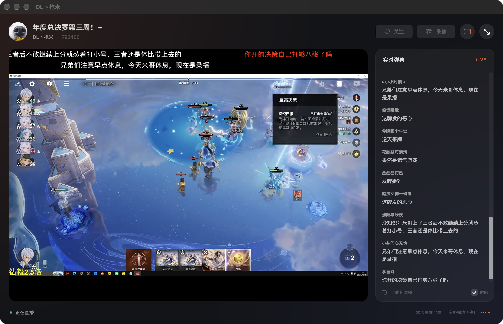
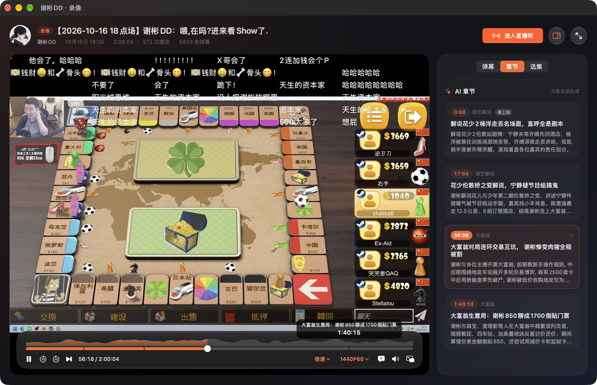
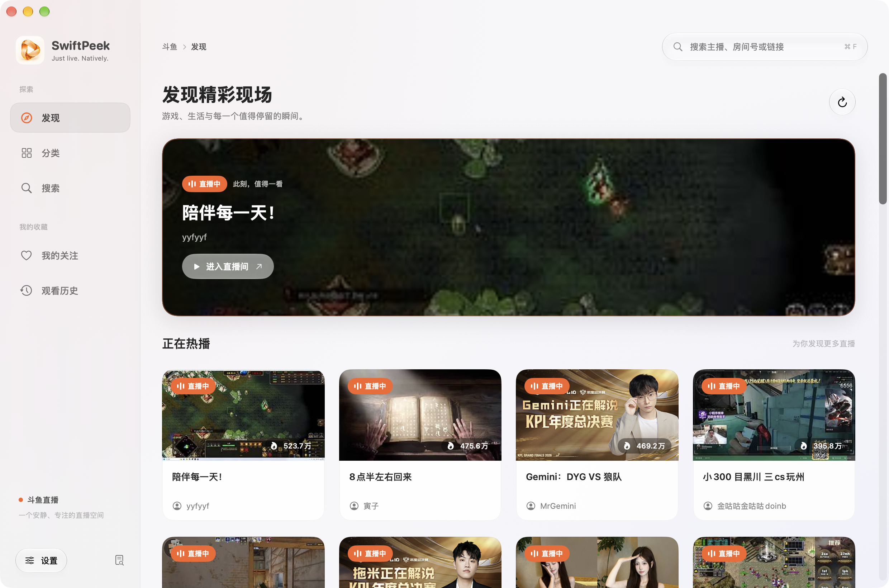
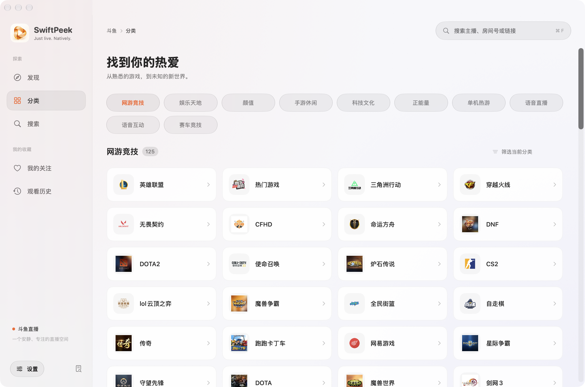
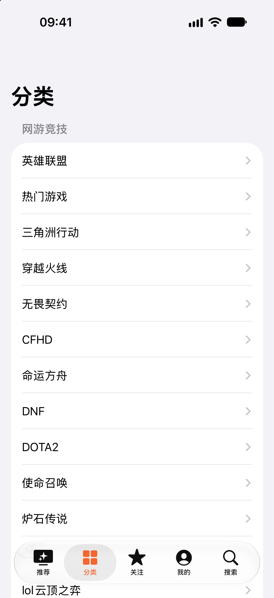
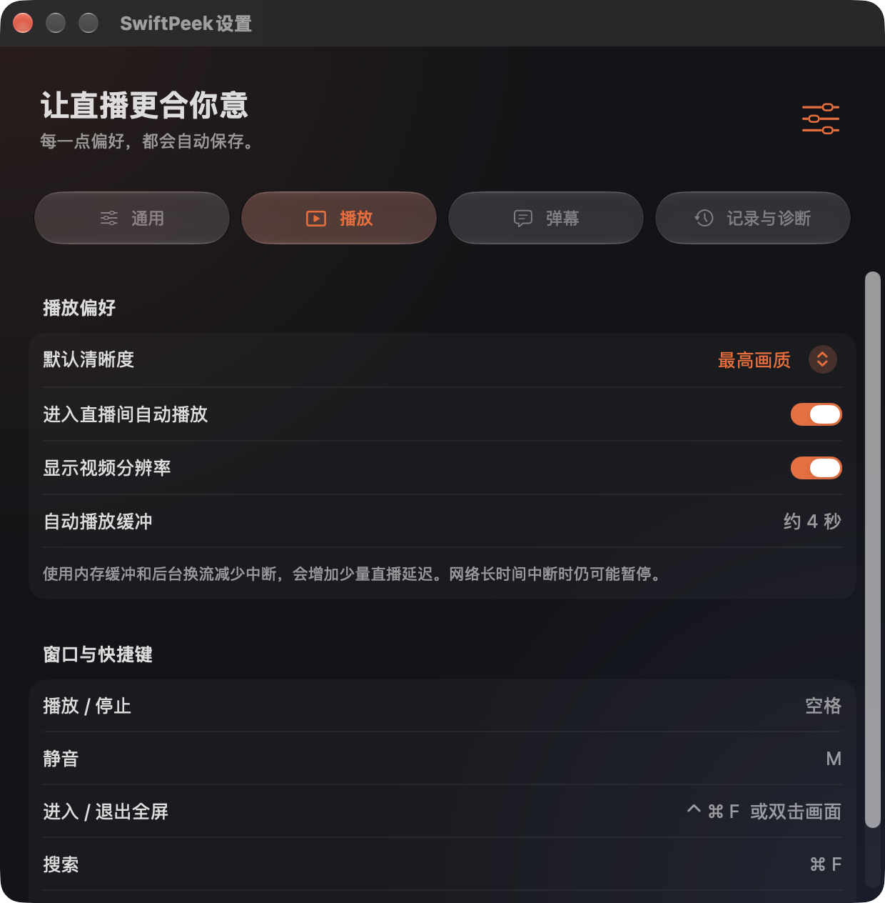
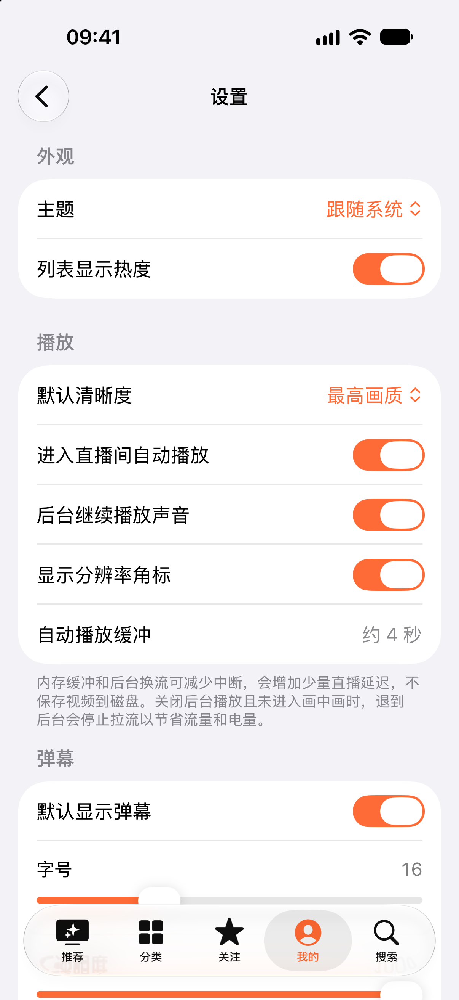

<p align="center">
  
</p>

<h1 align="center">SwiftPeek</h1>

<p align="center"><strong>Native Douyu live streaming &amp; replay player for Mac, iPhone Duo, iPhone, and iPad</strong></p>
<p align="center">Just live. Natively. · Danmaku · Picture in Picture · Chat density timeline · AI chapters</p>
<p align="center">Swift · SwiftUI · iOS 26+ · macOS 26+ · GPL-3.0</p>

<p align="center"><a href="README.md">简体中文</a> · English</p>

SwiftPeek is an open-source, third-party Douyu client for macOS, iOS, and iPadOS, built with Swift and SwiftUI.
Watch live streams or past broadcasts with timed danmaku (scrolling chat), Picture in Picture, and customizable chat overlays.
Replay timelines show chat density and AI chapter summaries to help you jump to a moment.
**iPhone Duo support** includes adaptive layouts for the foldable inner and outer displays, portrait, landscape, and partially folded poses.

> **Standing on the shoulders of giants—and AI.**
>
> SwiftPeek originated from [Simple Live by xiaoyaocz](https://github.com/xiaoyaocz/dart_simple_live).
> The upstream project's work on streaming platforms, stream URLs, and live chat made this project possible.
> Building on that foundation, I worked extensively with AI on design, implementation, debugging, and iteration
> to gradually rebuild the client using native Swift technologies.
> Thank you to the original author, upstream contributors, the open-source community, and the AI tools involved.

**The current native version supports Douyu only.** Dart code for other platforms is retained as migration reference; it does not mean those platforms are supported by the native apps.
The `reference/` directory is excluded from native builds and marked as vendored code in `.gitattributes`, so it does not count toward GitHub's language statistics.
The project is still evolving. Feedback from actual playback, background transitions, and cross-device sharing is welcome.

## Downloads and privacy

The latest iOS release is **[0.8.5 (19)](https://github.com/Rladmsrl/SwiftPeek/releases/tag/v0.8.5-ios)**. The latest macOS release is **[0.8.5 (19)](https://github.com/Rladmsrl/SwiftPeek/releases/tag/v0.8.5-macos)**. Both apps get a refreshed interface: cleaner cards and reorganized follows, category sections, and player info rows.

| Platform | Download | Requirements and installation |
| --- | --- | --- |
| macOS | [Universal ZIP](https://github.com/Rladmsrl/SwiftPeek/releases/download/v0.8.5-macos/SwiftPeek-0.8.5-macOS-universal.zip) | macOS 26+; arm64 and x86_64; extract and move the app to Applications |
| iPhone / iPad | [Unsigned IPA](https://github.com/Rladmsrl/SwiftPeek/releases/download/v0.8.5-ios/SwiftPeek-0.8.5-iOS-unsigned.ipa) | iOS / iPadOS 26+, arm64; sign with your own identity before sideloading; cannot be installed directly |

iOS: [Matching source](https://github.com/Rladmsrl/SwiftPeek/releases/download/v0.8.5-ios/SwiftPeek-0.8.5-source.zip) · [SHA-256 checksums](https://github.com/Rladmsrl/SwiftPeek/releases/download/v0.8.5-ios/SHA256SUMS.txt). For macOS source and checksums, see the [0.8.5 macOS release](https://github.com/Rladmsrl/SwiftPeek/releases/tag/v0.8.5-macos).

The Mac app is ad-hoc signed and has not been notarized with Developer ID. Gatekeeper may block the first launch; after checking the source and checksum, follow the system prompts in System Settings → Privacy & Security to allow this app. The Intel slice is cross-compiled; it has not been tested on Intel hardware or a Mac running macOS 26.

The iOS IPA contains no maintainer signing identity or provisioning profile. Device Release compilation and package privacy checks passed, but installation, launch, and playback after re-signing this IPA have not been verified on a physical device.

Starting with 0.8.0, follow sharing excludes watch history by default, local diagnostics are opt-in, and settings can clear viewing records and logs. The app connects directly to Douyu and its CDNs; it is not an anonymity proxy. See [privacy details](PRIVACY.md), [iOS installation notes](ios_native/README.md#下载与侧载), and [release instructions](docs/releases.md) in Chinese.

## iPhone Duo support

SwiftPeek adapts Douyu live streams, replays, and danmaku to the space available on iPhone Duo:

- **Fold and unfold:** video and chat / episodes stack in narrow spaces and sit side by side in wider spaces, preserving the current page, playback session, and replay position.
- **Portrait, landscape, and partial folds:** video, recommendation cards, and controls avoid the fold; native navigation adapts across displays, and exiting fullscreen keeps the current pose.
- **PiP danmaku:** live streams and replays share an independent composition queue with CPU/vImage drawing to improve background chat animation.

The following checks concern earlier development builds, not re-signing or installation of the current public IPA.
Pose and interaction checks were completed on the iPhone Duo / iOS 27.1 Simulator. The maintainer also installed and tried the build on an iOS 27.2 device and confirmed it was usable.
Actual PiP display rates depend on the device and load; a 60 fps scheduling target is not a claim of a constant measured device frame rate.
See [Duo compatibility and validation](docs/iphone-duo.md) and [PiP danmaku performance](docs/pip-danmaku-performance.md) (Chinese).

## Screenshots

### Watch live · Video and chat together

Switch quality and CDN while watching, with scrolling chat and a synchronized chat list. Mac uses a separate playback window; iPhone supports landscape viewing and touch gestures. Open a creator's past broadcasts directly from the replay button in their live room.

<table>
  <tr><th>macOS · Separate stream window</th><th>iOS · Video and live chat</th></tr>
  <tr>
    <td width="72%" valign="top"></td>
    <td width="28%" valign="top"></td>
  </tr>
</table>

### Watch replays · Find the moment on the timeline

Chat plays back on its original timeline. Chat density and chapter markers help you find busy moments, while AI chapters provide event titles and summaries you can tap to jump straight to a segment.

<table>
  <tr><th>macOS · Chat density and AI chapters</th><th>iOS · Replay and event summaries</th></tr>
  <tr>
    <td width="72%" valign="top"></td>
    <td width="28%" valign="top"></td>
  </tr>
</table>

- **Find a moment:** hover over the Mac timeline to preview a time and chapter title; tap a chapter on either platform to seek, with the current chapter highlighted.
- **Pick up where you left off:** saved progress per segment, 0.5×–2× speed, and automatic continuation to the next segment of the broadcast.
- **Chat follows playback:** pause freezes chat, seeking realigns it, and timestamps in the chat list let you jump to a comment.

Douyu provides AI chapters for some replays, including event titles and summaries. These are not speech subtitles. See [replay details (Chinese)](docs/replay.md).

<details>
<summary>More screens · Discover and categories</summary>

| macOS | iOS |
| :---: | :---: |
|  |  |
|  |  |

</details>

<details>
<summary>More screens · Playback and chat settings</summary>

| macOS · Dark appearance | iOS |
| :---: | :---: |
|  |  |

</details>

These are earlier v0.5.0 screenshots, captured in the iOS Simulator and native macOS app windows; they do not show the new Duo layouts.
Stream covers and titles are public content at capture time and may change. Screenshots do not establish sustained playback reliability.
See [capture notes](docs/screenshots/README.md).

## Features

- **Browse streams:** recommendations, categories, room and creator search, and opening rooms by ID or link.
- **Focused playback:** HTTP-FLV playback with H.264 / AAC, quality and CDN selection, volume, mute, and fullscreen.
- **Buffering and background handoff:** approximately four seconds of in-memory media buffering, with fresh credentials and a replacement connection prepared before handoff.
- **Danmaku and live chat:** scrolling chat overlays and a chat list, with font selection, size, speed, opacity, display area, and keyword filters; optional chat overlays in Picture in Picture.
- **Replays:** browse a creator's past broadcasts by session and watch them with chat replayed on its original timeline; the scrubber shows chat density and AI chapters, and playback resumes where you left off. [Details (Chinese)](docs/replay.md)
- **Follows and history:** local storage, plus follow-list files (watch history is included only when explicitly selected) that can be shared through AirDrop and manually merged between Mac and iPhone.
- **iPhone Duo compatibility:** adaptive inner and outer displays, portrait, landscape, and partial folds, with playback sessions preserved across changes.
- **Native interfaces:** SwiftUI, Liquid Glass controls, light and dark appearances, and platform-appropriate window and input behavior.

| | iOS / iPadOS | macOS |
| --- | --- | --- |
| Interface | Tabs, adaptive split layouts, portrait / landscape, iPhone Duo foldable layouts | Sidebar, adaptive cards, separate stream windows |
| Input | Touch gestures, volume and brightness controls | Mouse, keyboard shortcuts, resizable windows |
| Floating playback | System Picture in Picture, optional danmaku | Movable, resizable window with optional pinning and danmaku |
| Background behavior | Follows background-audio and PiP preferences | Stream windows keep playing while browsing the main window |
| Follow sharing | System share sheet and file import | System share sheet and file import |
| Replays | List and player pages, landscape fullscreen gestures | Separate replay windows, keyboard shortcuts |

Buffering adds some startup time and live latency. Background handoff aims to reduce visible interruptions; it does not guarantee seamless playback during network outages, platform API changes, or CDN switches.
Follow sharing is a manual merge, not real-time iCloud synchronization. Importing the same file again does not add duplicates or remove existing follows or history.

## Origins and changes

[Simple Live](https://github.com/xiaoyaocz/dart_simple_live) is this project's most important upstream source.
SwiftPeek retains its focus on simple live viewing and references or ports its platform integration, signing, stream retrieval, and chat implementations.

This project's main work is the native Apple-platform rebuild: Swift / SwiftUI interfaces, AppKit / UIKit integration,
HTTP-FLV demuxing and playback through Apple's media frameworks, buffering and handoff, cross-device follow sharing,
and the accompanying checks and documentation. That work builds on upstream contributions; rewriting in Swift does not erase their provenance.

This public repository starts with a privacy-reviewed source snapshot and an independent history. It does not include private development branches or earlier private commits.
The original Flutter implementation is available in the [upstream repository](https://github.com/xiaoyaocz/dart_simple_live).
Files under `reference/` are migration references only; building the native apps does not require Flutter.
SwiftPeek is independently maintained and is not an official release of the upstream project or any streaming platform.

## AI involvement

AI has been an active development collaborator. Tools including Codex have contributed to design discussions,
implementation, UI iteration, log analysis, code review, tests, and documentation. The current app icon also originated
from AI-generated candidates, selected by the maintainer and exported for both platforms.

The maintainer sets the direction, makes product decisions, provides real-world feedback, and remains responsible for maintenance and releases.
We distinguish between implementation, successful builds and offline checks, and physical-device verification.
An AI assessment or a passing build is not a substitute for complete testing.

## Build from source

### Requirements

- A macOS development environment. Build iOS / iPhone Duo with Xcode 27.1 or newer and the iOS 27.1+ SDK; the deployment target remains iOS 26. The Mac build uses the macOS 27+ SDK and targets macOS 26 or later.
- Swift 6.2 or newer; the current source uses Swift 5 language mode.
- [XcodeGen](https://github.com/yonaskolb/XcodeGen), which generates the Xcode projects from `project.yml`.

With Homebrew, install XcodeGen using `brew install xcodegen`. Run the following commands from the repository root.

### macOS

```sh
./macos_native/build.sh
```

Output: `macos_native/build/Build/Products/Release/SwiftPeek.app`.
The script builds the app without launching it. It uses local ad-hoc signing by default, not Developer ID notarization or a public distribution package.

### iOS / iPadOS

```sh
xcodegen generate --spec ios_native/project.yml
open ios_native/SimpleLive.xcodeproj
```

In Xcode, select the `SimpleLive` scheme and your device, choose your own development team under **Signing & Capabilities**, then build and run.
The project does not include the maintainer's signing team.

To check a device-target build without signing or installing it:

```sh
DEVELOPER_DIR=/Applications/Xcode.app/Contents/Developer \
xcodebuild -project ios_native/SimpleLive.xcodeproj \
  -scheme SimpleLive -configuration Release \
  -destination 'generic/platform=iOS' \
  -derivedDataPath ios_native/build \
  CODE_SIGNING_ALLOWED=NO ENABLE_CODE_COVERAGE=NO build
```

An unsigned build cannot be installed directly on an iPhone. Additional platform notes are available for [iOS](ios_native/README.md) and [macOS](macos_native/README.md) in Chinese.

### Tests

```sh
cd ios_native/SimpleLiveKit
swift test
```

Offline regression checks cover buffering, cancellation, background handoff, follow import, and mobile-session lifecycle behavior without opening an app window or connecting to a live stream.
Commands and build prerequisites are documented in [Development and validation](docs/development.md) (Chinese).
A successful build or offline check does not establish that every device, network, or PiP transition has been tested.

## Repository layout

```text
SwiftPeek/
├── ios_native/
│   ├── App/                 iOS UI, shared playback, and local data logic
│   ├── SimpleLiveKit/       Platform interfaces, Douyu signing/chat, data models
│   └── project.yml          iOS project configuration
├── macos_native/
│   ├── App/                 Mac UI and window sessions
│   ├── Checks/              Offline regression checks
│   └── project.yml          macOS project configuration
├── shared/                  Shared branding assets
├── design/                  Icon sources, prompts, and export records
├── reference/               Upstream Dart / Flutter migration references
└── docs/                    Design, review, and usage documentation
```

The names `SimpleLiveKit`, existing Xcode targets and schemes, bundle IDs, data directories, and the `.simplelivefollows` file format are retained for compatibility with existing installations and data.
The user-facing application name is **SwiftPeek**.

## Current limitations

- Douyu is the only native platform integration. Huya, Bilibili, and Douyin have not yet been ported.
- The player currently supports H.264 + AAC; HEVC streams are not supported.
- Follow sharing requires compatible app versions on both devices and does not automatically synchronize changes or deletions.
- The Mac floating window uses public AppKit APIs; it is not a system AVKit PiP panel.
- This project is a client, not a streaming-source service. It does not host or redistribute stream content.

## Contributing

Issues and pull requests are welcome, especially reports involving playback, background transitions, and cross-device import.
Please include the OS version, app version, room ID, approximate time, and reproduction steps. Review logs before posting and remove any information you do not want to make public.

For additional platform integrations, start with `reference/` and the `LiveSite` protocol in `SimpleLiveKit`.

## Disclaimer

The following is a translation of the statement retained from the [upstream Simple Live README](https://github.com/xiaoyaocz/dart_simple_live#声明):

> All features of this project are developed using publicly available information on the Internet, without any cracking or reverse engineering.
>
> This project is intended solely for learning and exchanging programming knowledge. Commercial use is strictly prohibited. Any commercial activity is unrelated to this project.
>
> If any part of this project infringes your lawful rights or interests, please contact the developer, who will promptly remove the relevant content.

You can contact the maintainer through this repository's [Issues](https://github.com/Rladmsrl/SwiftPeek/issues). Do not post sensitive personal information in a public issue.

**License clarification:** The statement above preserves the upstream project's intended purpose and maintenance position.
Rights to use, modify, and distribute the code are governed by [GPL-3.0](LICENSE), which permits commercial use.
The purpose statement does not impose additional restrictions on GPL-granted rights. See the [GNU GPL FAQ](https://www.gnu.org/licenses/gpl-faq.html#NoMilitary).

## License and acknowledgments

This project retains the upstream **GPL-3.0** license. See [LICENSE](LICENSE) for the full text.
Third-party components retain their respective licenses and copyright notices; see [Provenance and acknowledgments](THIRD_PARTY_NOTICES.md).

Special thanks to **[xiaoyaocz](https://github.com/xiaoyaocz)**, **[Simple Live](https://github.com/xiaoyaocz/dart_simple_live)**,
and all upstream contributors. Thanks also to CryptoJS, Tars, the other open-source projects involved, and the AI tools that supported development.

Thank you to the **[LINUX DO](https://linux.do/) community** for its discussions and sharing.

**Standing on the shoulders of giants and AI, to make watching live streams a little simpler.**
